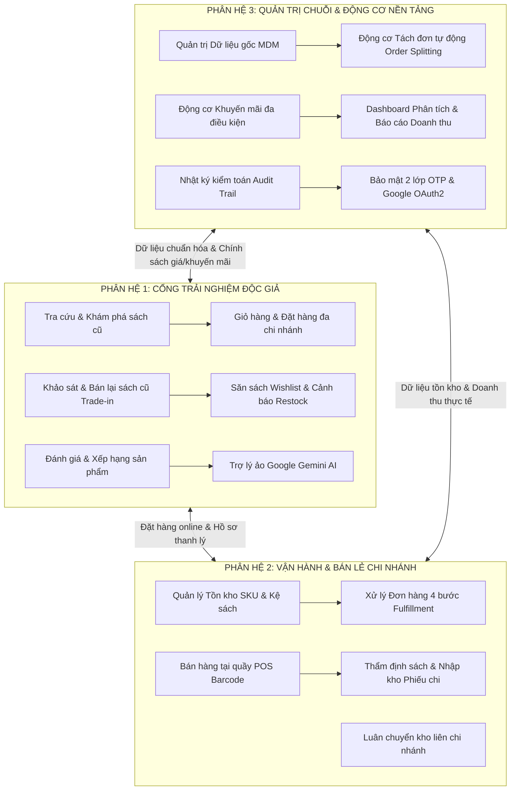

# TÀI LIỆU TỔNG HỢP CÁC NHÓM CHỨC NĂNG HỆ THỐNG
## DỰ ÁN: HỆ THỐNG QUẢN LÝ CHUỖI CỬA HÀNG SÁCH CŨ ĐA CHI NHÁNH (BOOK4LIFE)

---

## MỤC LỤC
1. [TỔNG QUAN HỆ THỐNG & PHÂN QUYỀN VAI TRÒ (RBAC)](#1-tổng-quan-hệ-thống--phân-quyền-vai-trò-rbac)
2. [KIẾN TRÚC TỔNG THỂ 3 PHÂN HỆ NGHIỆP VỤ](#2-kiến-trúc-tổng-thể-3-phân-hệ-nghiệp-vụ)
3. [CHI TIẾT PHÂN HỆ 1: CỔNG TRẢI NGHIỆM ĐỘC GIẢ (CUSTOMER PORTAL)](#3-chi-tiết-phân-hệ-1-cổng-trải-nghiệm-độc-giả-customer-portal)
4. [CHI TIẾT PHÂN HỆ 2: VẬN HÀNH & BÁN LẺ CHI NHÁNH (BRANCH OPERATIONS & FULFILLMENT)](#4-chi-tiết-phân-hệ-2-vận-hành--bán-lẻ-chi-nhánh-branch-operations--fulfillment)
5. [CHI TIẾT PHÂN HỆ 3: QUẢN TRỊ CHUỖI & ĐỘNG CƠ NỀN TẢNG (HQ GOVERNANCE & PLATFORM ENGINES)](#5-chi-tiết-phân-hệ-3-quản-trị-chuỗi--động-cơ-nền-tảng-hq-governance--platform-engines)
6. [HẠ TẦNG EMAIL GIAO DỊCH ĐA KÊNH & KHẢ NĂNG TƯƠNG THÍCH CLOUD](#6-hạ-tầng-email-giao-dịch-đa-kênh--khả-năng-tương-thích-cloud)
7. [BẢNG ĐỐI SOÁT MÃ CHỨC NĂNG THEO SRS CHUẨN HÓA (REQUIREMENTS MATRIX)](#7-bảng-đối-soát-mã-chức-năng-theo-srs-chuẩn-hóa-requirements-matrix)
8. [NGĂN XẾP CÔNG NGHỆ & TỐI ƯU HIỆU NĂNG TRIỂN KHAI](#8-ngăn-xếp-công-nghệ--tối-ưu-hiệu-năng-triển-khai)
9. [KỊCH BẢN & TRÌNH TỰ QUAY CLIP GIỚI THIỆU HỆ THỐNG (DEMO STORYBOARD)](#9-kịch-bản--trình-tự-quay-clip-giới-thiệu-hệ-thống-demo-storyboard)

---

## 1. TỔNG QUAN HỆ THỐNG & PHÂN QUYỀN VAI TRÒ (RBAC)

**Book4Life** là giải pháp phần mềm chuyên sâu kết hợp hoàn hảo giữa **Thương mại điện tử B2C**, **Thu cũ đổi mới từ độc giả C2B (Trade-in / Buy-back)** và **Hệ thống ERP thu nhỏ**, phục vụ quản trị chuỗi cung ứng, kho bãi vật lý và tài chính cho mô hình chuỗi cửa hàng sách cũ đa chi nhánh.

### Ma trận Phân quyền Vai trò Người dùng (Role-Based Access Control)
| Vai trò (Role) | Ký hiệu hệ thống | Phạm vi & Trách nhiệm chính |
| :--- | :--- | :--- |
| **Quản trị viên chuỗi** | `ROLE_ADMIN` | Quản trị dữ liệu gốc (MDM), cấu hình voucher toàn chuỗi, duyệt tài khoản, phân bổ nhân sự, giám sát báo cáo tài chính tổng hợp, quản trị xóa tài khoản an toàn (Cascade Deletion). |
| **Quản lý chi nhánh** | `ROLE_BRANCH_MANAGER` | Quản lý vận hành chi nhánh phụ trách, giám sát đơn hàng, tạo và duyệt yêu cầu luân chuyển kho nội bộ, quản lý tài xế và nhân viên tại chỗ. |
| **Chuyên viên thẩm định** | `ROLE_STAFF_APPRAISER` | Tiếp nhận yêu cầu bán sách từ khách, thẩm định độ cũ (Grade), định giá mua, đối soát thực tế tại quầy, duyệt nhập kho và tạo phiếu chi. |
| **Nhân viên bán lẻ & kho** | `ROLE_STAFF_WAREHOUSE` / `STAFF_GENERAL` | Nhặt sách đóng gói theo đơn online, cập nhật vị trí kệ sách, bán hàng tại quầy (POS), xác nhận xuất/nhập phiếu luân chuyển. |
| **Tài xế giao vận** | `ROLE_STAFF_DRIVER` | Tiếp nhận đơn giao từ chi nhánh, cập nhật tiến độ giao vận nội thành, xác nhận giao hàng thành công. |
| **Khách hàng / Độc giả** | `ROLE_CUSTOMER` | Tìm sách theo chi nhánh, mua hàng online, gửi yêu cầu thanh lý sách cũ, săn sách hết hàng, đánh giá chất lượng và chat cùng AI. |

---

## 2. KIẾN TRÚC TỔNG THỂ 3 PHÂN HỆ NGHIỆP VỤ

Hệ thống được thiết kế theo mô hình 3 phân hệ tương hỗ khép kín:

---

## 3. CHI TIẾT PHÂN HỆ 1: CỔNG TRẢI NGHIỆM ĐỘC GIẢ (CUSTOMER PORTAL)

> **Mục tiêu:** Mang lại trải nghiệm tìm kiếm minh bạch, quy trình mua sắm tiện lợi và khả năng tương tác hai chiều (Mua B2C & Bán C2B).

### 3.1. Tìm kiếm & Khám phá Sách cũ Trực quan
* **Tra cứu theo chi nhánh & Đồng bộ tồn kho:** Xem chính xác cuốn sách đang có mặt tại cửa hàng nào trong chuỗi (Chi nhánh Quận 1, Quận 5, Thủ Đức, Hoàn Kiếm, v.v.). Hệ thống chỉ hiển thị các chi nhánh **thực tế còn sách sẵn sàng bán (`AVAILABLE` và `stockQuantity > 0`)**. Tự động gắn huy hiệu **"GIÁ TỐT NHẤT ⭐"** cho cơ sở có mức giá ưu đãi nhất.
* **Thang đo độ cũ minh bạch (Grading Scale):**
  * `LIKE_NEW` (99% - Như mới, bìa phẳng phiu, không tỳ vết).
  * `VERY_GOOD` (90% - Rất tốt, gáy nguyên vẹn, giấy sáng).
  * `GOOD` (80% - Tốt, dấu thời gian nhẹ, không rách trang).
  * `ACCEPTABLE` (60% - Đọc tốt, có thể ngả vàng hoặc có vết chú thích).
* **Hình ảnh thực tế đa góc cạnh từ Cloudinary:** Cho phép độc giả xem chi tiết từng mép sách, gáy sách trước khi quyết định mua.

### 3.2. Giỏ hàng Thông minh & Đặt hàng Linh hoạt
* **Giỏ hàng nguồn gốc chi nhánh:** Tự động gom nhóm sách theo cửa hàng sở hữu.
* **Hình thức nhận sách đa dạng:**
  * **Giao tận nơi (COD):** Tự động tính phí vận chuyển theo Tỉnh/Thành phố dựa trên địa chỉ khách chọn.
  * **Giữ sách tại quầy (Click & Collect):** Độc giả đặt trước và ghé chi nhánh gần nhất nhận sách trong 48 giờ hoàn toàn miễn phí vận chuyển.
* **Đăng nhập Google trực tiếp chuẩn OAuth2:** Loại bỏ hoàn toàn tài khoản gợi ý cứng; độc giả nhập tài khoản Google cá nhân và hoàn tất xác thực trong 1-click mà không cần mật khẩu hay mã OTP.
* **Tối ưu form điền thông tin:** Sử dụng placeholder mờ hiển thị tên trường rõ ràng (Họ và tên, Số điện thoại, Địa chỉ, Ghi chú), không để dữ liệu mẫu gây nhầm lẫn.

### 3.3. Quy trình Thu Cũ Đổi Mới (C2B Trade-in / Buy-back)
* **Khảo sát trực tuyến:** Khách hàng điền tựa sách, thể loại, năm xuất bản và tải lên 6 ảnh chụp thực tế (bìa trước, bìa sau, gáy sách, mép giấy, trang lót, vết tỳ vết).
* **Thuật toán định giá sơ bộ tự động (*Auto-Appraisal Algorithm*):** Hệ thống tự động tính giá đề xuất ban đầu dựa trên giá bìa gốc, năm xuất bản và tỷ lệ trừ theo mức độ hư hại.
* **Theo dõi tiến trình trực tiếp:** Nhận thông báo kết quả thẩm định chính thức và mã biên lai để mang sách đến quầy nhận tiền mặt hoặc đổi lấy voucher mua sách mới.

### 3.4. Tiện ích Giữ chân & Chăm sóc Khách hàng
* **"Săn sách" & Cảnh báo sách về kho (Wishlist & Restock Alert):** Độc giả đăng ký theo dõi các cuốn sách hiếm đã hết hàng. Khi bất kỳ chi nhánh nào nhập kho, hệ thống tự động gửi Email thông báo kèm link chi tiết sách.
* **Đánh giá & Xếp hạng sản phẩm (Reviews & Ratings):** Khách hàng sau khi hoàn tất đơn được quyền gửi đánh giá thực tế, chấm điểm sao (mặc định 5 sao) và nhận xét chất lượng bảo quản sách.
* **Trợ lý ảo thông minh Google Gemini AI:** Chatbot tích hợp trực tiếp trên web, đóng vai trò "thủ thư ảo" tư vấn sách theo gu đọc, kiểm tra tồn kho và giải đáp chính sách 24/7. Hỗ trợ tính năng **Chuyển tiếp cho nhân viên thật (Human Handoff)** qua email hotline tự động.

---

## 4. CHI TIẾT PHÂN HỆ 2: VẬN HÀNH & BÁN LẺ CHI NHÁNH (BRANCH OPERATIONS & FULFILLMENT)

> **Mục tiêu:** Chuẩn hóa quy trình vận hành tại từng cửa hàng, đảm bảo tính chính xác về tồn kho vật lý và tốc độ hoàn tất đơn hàng.

### 4.1. Quản lý Tồn kho Vật lý & Định vị Kệ sách (Branch Inventory)
* **Kiến trúc sách 2 tầng (2-Tier Architecture):** Tách biệt rõ ràng giữa *Đầu sách gốc (Book Master)* và các *Bản sao vật lý thực tế (Book Item / SKU)*.
* **Mã định danh SKU Barcode:** Mỗi cuốn sách khi vào kho được cấp mã vạch riêng gắn liền với độ cũ và giá bán riêng biệt.
* **Quản lý vị trí kệ (`shelfLocation`):** Lưu chính xác vị trí sách trên kệ (ví dụ: *Kệ A2 - Tầng 3 - Dãy Văn Học*), giúp nhân viên tìm và nhặt sách chỉ trong vài giây.

### 4.2. Xử lý & Hoàn tất Đơn hàng Đa bước (Order Fulfillment Pipeline)
Quy trình khép kín 4 bước rõ ràng:
1. **Tiếp nhận & Phê duyệt:** Nhân viên kiểm tra sách trên kệ và bấm `1. Phê Duyệt & Tiếp Nhận Đơn Hàng` (`PENDING` $\rightarrow$ `CONFIRMED`).
2. **Xuất kho & Đóng gói:** Bấm `2. Bắt Đầu Xuất Kho & Đóng Gói` (`PACKING`).
3. **Phân công vận chuyển:** Chọn tài xế nội bộ của chi nhánh hoặc chọn đơn vị giao vận (GHTK, GHN, AhaMove) kèm mã vận đơn (`SHIPPED`).
4. **Hoàn tất giao hàng:** Xác nhận khách đã nhận sách thành công (`COMPLETED`).
* **Hủy đơn & Hoàn kho tự động:** Trong trường hợp khách hủy đơn hoặc giao thất bại, hệ thống tự động hoàn trả số lượng sách về kho lưu trữ ban đầu bằng Database Transaction an toàn.

### 4.3. Thẩm định & Nhập kho Thu mua Sách cũ
* **Bàn làm việc của Chuyên viên thẩm định (Staff Appraiser):** Soi ảnh chụp phóng to chất lượng cao, đối chiếu bảng tiêu chí hư hại, chốt mức điểm Grade và giá mua chính thức.
* **Đối soát tại quầy:** Khi khách mang sách đến, nhân viên kiểm tra tình trạng thực tế so với hồ sơ online, bấm **Xác nhận nhập kho**, gán vị trí kệ và tự động lập phiếu chi tiền mặt cho khách.

### 4.4. Bán lẻ tại Quầy (Point of Sale - POS)
* Giao diện quẹt Barcode/SKU siêu tốc phục vụ khách mua trực tiếp tại cửa hàng.
* Tìm kiếm sách nhanh theo tên tác giả hoặc tựa đề, áp dụng mã voucher khuyến mãi và tính tiền thối tự động.

### 4.5. Luân chuyển Kho Liên Chi nhánh (Internal Stock Transfer)
* Quản lý chi nhánh lập phiếu đề xuất điều chuyển sách giữa các cửa hàng khi có sự chênh lệch nhu cầu.
* **Ràng buộc kiểm tra tự động:** Hệ thống tự động từ chối điều chuyển nếu cuốn sách đó mới nhập dưới 6 tháng mà tại chi nhánh nguồn chỉ còn duy nhất 1 cuốn (nhằm chống cạn kiệt nguồn sách độc bản).
* Luồng trạng thái chuẩn: *Đề xuất $\rightarrow$ Xuất kho nguồn $\rightarrow$ Đang vận chuyển $\rightarrow$ Nhập kho đích*.

---

## 5. CHI TIẾT PHÂN HỆ 3: QUẢN TRỊ CHUỖI & ĐỘNG CƠ NỀN TẢNG (HQ GOVERNANCE & PLATFORM ENGINES)

> **Mục tiêu:** Kiểm soát tập trung toàn bộ dữ liệu, tối ưu hóa các thuật toán phân bổ và bảo đảm an ninh hệ thống toàn chuỗi.

### 5.1. Quản trị Dữ liệu Gốc Tập trung (Master Data Management - MDM)
* Chuẩn hóa danh mục thống nhất: Tác giả, Thể loại và Đầu sách gốc toàn chuỗi.
* **Thống nhất tồn kho toàn chuỗi với chi nhánh:** Số lượng tồn kho toàn chuỗi hiển thị ở Master Data và Analytics được tính bằng tổng số lượng sách `AVAILABLE` có thực tế tại tất cả các chi nhánh cộng lại (`sumAvailableStock`), đảm bảo tính nhất quán tuyệt đối giữa dữ liệu quản trị chuỗi và kho hàng cơ sở.
* Tự động kiểm tra trùng lặp ISBN khi nhập liệu và công cụ tự sinh mã ISBN-13 chuẩn quốc tế.

### 5.2. Động cơ Định tuyến & Tách đơn Tự động (Order Routing & Splitting Engine)
* Khi giỏ hàng của khách hàng chứa các cuốn sách thuộc nhiều chi nhánh khác nhau, hệ thống tự động phân tách thành 1 Đơn hàng mẹ (`MasterOrder`) và các Đơn hàng con (`SubOrder`) tương ứng với từng chi nhánh sở hữu.
* Mỗi chi nhánh chỉ nhận và xử lý phần sách thuộc kho của mình, đảm bảo tính độc lập và minh bạch trong việc hạch toán doanh thu.

### 5.3. Động cơ Khuyến mãi Đa điều kiện (Coupons & Discounts Engine)
* Thiết lập đa dạng loại voucher:
  * Giảm theo % giá trị sách (kèm trần giảm tối đa).
  * Giảm số tiền cố định (VNĐ).
  * Freeship 100% hoặc giảm phí vận chuyển cố định.
* Cấu hình điều kiện lọc sâu:
  * Giá trị đơn hàng tối thiểu (`minOrderAmount`).
  * Giới hạn theo **Độ cũ của sách** (ví dụ: chỉ áp dụng cho sách cũ tình trạng `GOOD` hoặc `ACCEPTABLE` để kích cầu giải phóng hàng tồn).
  * Giới hạn chi nhánh áp dụng hoặc áp dụng toàn chuỗi.

### 5.4. Báo cáo Thống kê & Nhật ký Kiểm toán (Analytics & Audit Trail)
* **Analytics Dashboard:** Trực quan hóa doanh thu theo ngày/tháng, cơ cấu doanh thu theo chi nhánh, tỷ trọng sách bán chạy, tỷ lệ hoàn tất đơn hàng.
* **Audit Trail (Nhật ký kiểm toán):** Ghi nhận chi tiết lịch sử mọi hành vi quan trọng (ai đổi trạng thái đơn, thời gian thực hiện, ghi chú thao tác) phục vụ việc thanh tra và đối soát nội bộ.

### 5.5. Quản trị Xóa Tài Khoản Triệt Để (Cascade Deletion Governance)
* Khắc phục triệt để lỗi vi phạm khóa ngoại (Foreign Key Constraint Fails) khi xóa người dùng:
* Hệ thống triển khai quy trình xóa tầng phân cấp an toàn trong Transaction CSDL:
  1. `wishlists`
  2. `reviews`
  3. `ai_chat_messages`
  4. `trade_in_images` & `trade_in_requests` (gỡ liên kết nhân viên thẩm định)
  5. `stock_transfers` (gỡ liên kết nhân viên đề xuất)
  6. `order_status_history` (gỡ liên kết người cập nhật và xóa lịch sử đơn hàng của user)
  7. `coupon_usages`
  8. `sub_order_items`
  9. `sub_orders`
  10. `master_orders`
  11. `users` (Xóa chính thức tài khoản người dùng)

### 5.6. Hạ tầng Bảo mật & Xác thực Người dùng (Security & RBAC)
* **Xác thực OTP qua Email:** Mã hóa ngẫu nhiên 6 chữ số qua `SecureRandom`, lưu CSDL với thời hạn hiệu lực 5 phút, khóa sau 5 lần nhập sai để chống tấn công dò mã (Brute-force).
* **Đăng nhập Google 1-Click (Google Identity Services):** Đăng nhập trực tiếp bằng Google OAuth2, tự động giải mã JWT credential và cấp phiên làm việc Spring Security session.
* **Đo lường độ mạnh mật khẩu:** Ràng buộc an toàn bắt buộc mật khẩu phải `> 6 ký tự`, đồng thời chứa đủ chữ cái (a-z, A-Z), chữ số (0-9) và ký tự đặc biệt (!@#$...).
* **Kiến trúc Stateless:** Spring Security kết hợp JSON Web Token (JWT) lưu trữ an toàn trong HttpOnly Cookie, bảo vệ hệ thống trước các cuộc tấn công XSS và CSRF.

---

## 6. HẠ TẦNG EMAIL GIAO DỊCH ĐA KÊNH & KHẢ NĂNG TƯƠNG THÍCH CLOUD

> **Mục tiêu:** Đảm bảo 100% email giao dịch quan trọng (OTP, Chào mừng, Săn sách, Hotline) được phát đi thành công ngay cả trên các môi trường Cloud có tường lửa khắt khe.

### 6.1. Hỗ trợ Song Song Giao thức Kép: HTTPS REST API & SMTP
* **Ưu tiên 1: Brevo REST API v3 (Cổng HTTPS 443):**
  * Gọi trực tiếp tới `https://api.brevo.com/v3/smtp/email` qua giao thức HTTPS bảo mật.
  * **Giải pháp khắc phục triệt để việc Render chặn cổng SMTP:** Cổng 443 là cổng Web tiêu chuẩn nên hoàn toàn không bao giờ bị Render hay các nhà cung cấp Cloud (AWS, Vercel) chặn. Tốc độ phản hồi cực nhanh (~0.2 giây).
* **Ưu tiên 2: Fallback qua SMTP (Cổng 2525 / 587):**
  * Tự động chuyển đổi mượt mà sang `JavaMailSender` nếu chưa cấu hình API Key.
  * Sử dụng cổng chuyên dụng `2525` của Brevo để hạn chế tối đa việc xung đột với cổng `587`.
* **Ưu tiên 3: Hỗ trợ linh hoạt Gmail SMTP (`smtp.gmail.com`):** Dành cho môi trường phát triển cục bộ (Local Development) có App Password.

### 6.2. Bộ Email Mẫu Chuẩn Nhận Diện Thương Hiệu Book4Life
* **Email Mã xác nhận OTP Đăng ký:** Hiển thị mã 6 số to rõ ràng dạng `123 456`, kèm cảnh báo bảo mật và đồng hồ đếm ngược 5 phút.
* **Email Chào Mừng Độc Giả Mới (Welcome Email):** Tự động gửi tới email khách hàng vừa đăng ký thành công (hoặc đăng nhập Google lần đầu), tóm tắt các đặc quyền: mua sách cũ tiết kiệm 30%-70%, săn sách Wishlist, định giá thu cũ đổi mới bằng AI.
* **Email Cảnh Báo Săn Sách (Restock Alert):** Bắn thông báo ngay khi cuốn sách độc bản về kho kèm tên chi nhánh hiện có, tình trạng Grade và link xem chi tiết.
* **Email Chuyển Tiếp Hotline CSKH:** Định tuyến câu hỏi từ khung chat website về hộp thư nóng của ban quản trị để hỗ trợ độc giả kịp thời.

### 6.3. Công cụ Chẩn đoán Trực tiếp trên Cloud (`/api/test-email`)
* Cung cấp endpoint chẩn đoán thời gian thực `GET /api/test-email?to=...` giúp lập trình viên và quản trị viên kiểm tra tức thì trạng thái kết nối Brevo API, mã phản hồi HTTP và phát hiện ngay các lỗi về IP bảo mật hoặc cấu hình biến môi trường trên Render.

---

## 7. BẢNG ĐỐI SOÁT MÃ CHỨC NĂNG THEO SRS CHUẨN HÓA (REQUIREMENTS MATRIX)

| Mã Yêu cầu | Tên Chức Năng | Phân hệ | Đối tượng thao tác |
| :--- | :--- | :--- | :--- |
| **FR-AUTH-01** | Đăng ký tài khoản xác thực 2 bước qua Email OTP | Phân hệ 3 | Customer, Hệ thống |
| **FR-AUTH-02** | Đăng nhập trực tiếp 1-Click bằng tài khoản Google (OAuth2) | Phân hệ 3 | Customer, Hệ thống |
| **FR-AUTH-03** | Đánh giá độ mạnh mật khẩu và kiểm tra trùng lặp email thời gian thực | Phân hệ 3 | Customer |
| **FR-AUTH-04** | Tự động gửi Email Chào Mừng cho tài khoản mới kích hoạt | Phân hệ 3 | Hệ thống (Brevo API) |
| **FR-AUTH-05** | Phân quyền truy cập đa vai trò (RBAC 6 Roles) với JWT HttpOnly Cookie | Phân hệ 3 | Hệ thống, Toàn bộ Users |
| **FR-MDM-01** | Chuẩn hóa danh mục Đầu sách Master | Phân hệ 3 | Admin |
| **FR-MDM-02** | Quản lý Tác giả & Thể loại chuẩn | Phân hệ 3 | Admin |
| **FR-MDM-03** | Tra cứu & Kiểm tra trùng lặp ISBN | Phân hệ 3 | Admin, Staff |
| **FR-INV-01** | Tạo SKU mặt hàng sách cũ tại chi nhánh | Phân hệ 2 | Staff Warehouse |
| **FR-INV-02** | Chấm điểm tình trạng & Đặt giá bán riêng theo độ cũ | Phân hệ 2 | Staff Appraiser |
| **FR-INV-03** | Tải ảnh thực tế đa góc cạnh lên Cloudinary | Phân hệ 2 | Staff Appraiser |
| **FR-INV-04** | Quản lý Vị trí kệ sách (Shelf Location) | Phân hệ 2 | Staff Warehouse |
| **FR-ORD-01** | Giỏ hàng hiển thị nguồn gốc chi nhánh | Phân hệ 1 | Customer |
| **FR-ORD-02** | Thuật toán Tự động tách đơn (Order Splitting) | Phân hệ 3 | Hệ thống |
| **FR-ORD-03** | Trừ kho an toàn bằng Database Transaction | Phân hệ 2 | Hệ thống |
| **FR-ORD-04** | Đặt giữ sách tại quầy (Click & Collect) miễn phí ship | Phân hệ 1 | Customer, Staff |
| **FR-FUL-01** | Tiếp nhận & Phê duyệt đơn hàng tại chi nhánh | Phân hệ 2 | Staff Warehouse |
| **FR-FUL-02** | Quy trình đóng gói & Phân công tài xế giao vận | Phân hệ 2 | Staff, Driver |
| **FR-FUL-03** | Theo dõi tiến độ đơn hàng thời gian thực qua mã vận đơn | Phân hệ 1 | Customer |
| **FR-FUL-04** | Xử lý Hủy đơn & Tự động hoàn kho an toàn | Phân hệ 2 | Staff, Hệ thống |
| **FR-TRF-01** | Tạo phiếu đề xuất luân chuyển sách giữa các chi nhánh | Phân hệ 2 | Branch Manager |
| **FR-TRF-02** | Kiểm tra ràng buộc luân chuyển tự động (Chống cạn sách độc bản) | Phân hệ 3 | Hệ thống |
| **FR-TRF-03** | Quy trình Xuất kho nguồn - Vận chuyển - Nhập kho đích | Phân hệ 2 | Staff các chi nhánh |
| **FR-TRF-04** | Theo dõi lịch sử luân chuyển toàn chuỗi | Phân hệ 3 | Admin |
| **FR-WSH-01** | Đăng ký "Săn sách" khi sản phẩm hết hàng | Phân hệ 1 | Customer |
| **FR-WSH-02** | Tự động quét & Bắn Email thông báo có hàng (Restock Alert) | Phân hệ 1 | Hệ thống (Brevo / SMTP) |
| **FR-WSH-03** | Quản lý danh sách Săn sách cá nhân | Phân hệ 1 | Customer |
| **FR-CPN-01** | Thiết lập Mã giảm giá đa điều kiện (%, tiền mặt, freeship) | Phân hệ 3 | Admin |
| **FR-CPN-02** | Điều kiện giảm theo Độ cũ của sách (Grade) | Phân hệ 3 | Admin, Hệ thống |
| **FR-CPN-03** | Điều kiện giảm theo Chi nhánh áp dụng | Phân hệ 3 | Admin, Hệ thống |
| **FR-CPN-04** | Kiểm tra và Áp dụng mã trong Giỏ hàng | Phân hệ 1 | Customer, Hệ thống |
| **FR-TRD-01** | Điền thông tin khảo sát tình trạng sách cũ cần thanh lý | Phân hệ 1 | Customer |
| **FR-TRD-02** | Tải ảnh chụp thực tế 6 mặt lên Cloudinary | Phân hệ 1 | Customer |
| **FR-TRD-03** | Tự động tính giá định giá sơ bộ ban đầu | Phân hệ 1 | Hệ thống (Auto Algorithm) |
| **FR-TRD-04** | Chuyên viên thẩm định kiểm duyệt ảnh & Chốt giá chính thức | Phân hệ 2 | Staff Appraiser |
| **FR-TRD-05** | Khách hàng phản hồi kết quả định giá (Đồng ý / Từ chối) | Phân hệ 1 | Customer |
| **FR-TRD-06** | Nhận sách thực tế & Nhập kho - Tự động tạo phiếu chi tiền | Phân hệ 2 | Staff Appraiser |
| **FR-REV-01** | Đánh giá & Chấm điểm sao sau khi hoàn tất đơn hàng | Phân hệ 1 | Customer |
| **FR-REV-02** | Quản lý và duyệt đánh giá từ phía Admin | Phân hệ 3 | Admin |
| **FR-GEM-01** | Giao diện Chatbot thông minh trên Web | Phân hệ 1 | Customer, Guest |
| **FR-GEM-02** | Tư vấn tìm sách theo ngữ cảnh (Google Gemini AI) | Phân hệ 1 | Hệ thống, Google Gemini |
| **FR-GEM-03** | Giải đáp thắc mắc về độ cũ sách & chính sách thu cũ đổi mới | Phân hệ 1 | Hệ thống, Google Gemini |
| **FR-GEM-04** | Chuyển tiếp câu hỏi khó sang nhân viên thật qua Email Hotline | Phân hệ 1 | Customer, Staff |
| **FR-ADM-01** | Dashboard phân tích doanh thu và cơ cấu chi nhánh | Phân hệ 3 | Admin |
| **FR-ADM-02** | Nhật ký kiểm toán thao tác hệ thống (Audit Trail) | Phân hệ 3 | Admin |
| **FR-ADM-03** | Xóa tài khoản cascade toàn bộ đơn hàng và lịch sử liên quan | Phân hệ 3 | Admin |

---

## 8. NGĂN XẾP CÔNG NGHỆ & TỐI ƯU HIỆU NĂNG TRIỂN KHAI

### 8.1. Công nghệ Backend & Bảo mật
* **Ngôn ngữ & Nền tảng:** Java 21 LTS, Spring Boot 3.3.x.
* **Tầng dữ liệu:** Spring Data JPA, Hibernate ORM, HikariCP Connection Pool (tối ưu keep-alive 5 phút cho Cloud DB).
* **Bảo mật:** Spring Security 6, JWT (JSON Web Token) trong HttpOnly Cookie, mã hóa mật khẩu BCrypt, phòng chống tấn công CSRF, XSS và Brute-force.
* **Xử lý bất đồng bộ:** `@Async` với TaskExecutor chuyên biệt giúp gửi email không gây nghẽn luồng xử lý web.

### 8.2. Công nghệ Frontend & Giao diện
* **Template Engine:** Thymeleaf 3.x kết hợp Thymeleaf Extras Spring Security 6.
* **Framework UI:** Tailwind CSS, Bootstrap 5.3, Bootstrap Icons, Font Awesome 6.
* **Client-side Logic:** Vanilla JavaScript ES6+ (Async/Await, Fetch API, DOM Manipulation).

### 8.3. Dịch vụ Tích hợp & Đám mây (Cloud & Third-party Services)
* **Email Service:**
  * **Brevo REST API v3:** Giao tiếp qua cổng **HTTPS 443** (sử dụng `java.net.http.HttpClient` gốc của Java, miễn nhiễm 100% trước rào cản chặn cổng SMTP của Render).
  * **Brevo SMTP (Port 2525 / 587):** Giao thức truyền thống với JavaMailSender.
  * **Google SMTP (Gmail):** Dự phòng môi trường cục bộ.
* **Trí tuệ nhân tạo (AI):** Google Gemini 1.5 Flash API (xử lý ngôn ngữ tự nhiên, gợi ý sách thông minh).
* **Lưu trữ đa phương tiện:** Cloudinary CDN REST API (lưu trữ ảnh bìa sách và 6 góc ảnh thực tế của dịch vụ Trade-in).
* **Cơ sở dữ liệu đám mây:** Cloud Aiven MySQL Database / Microsoft SQL Server.
* **Nền tảng Hosting:** Render.com Cloud Platform.

### 8.4. Tối ưu Hiệu năng & Vận hành Tự động
* **Nén dữ liệu Gzip (HTTP Compression):** Kích hoạt `server.compression.enabled=true`, nén 70% - 85% dung lượng HTML, CSS, JS, JSON trả về cho trình duyệt.
* **Bộ nhớ đệm trình duyệt (Browser Cache Control):** Cấu hình `max-age=7d` lưu đệm ảnh, CSS, Javascript trên máy người dùng trong 7 ngày.
* **Cơ chế Tự động chống ngủ đông (Keep-Alive Self-Ping Service):** Tự động gửi tín hiệu ping định kỳ mỗi 12 phút tới `/api/ping`, ngăn ngừa Render Free Server rơi vào trạng thái ngủ đông (cold sleep).
* **Bộ Kiểm Thử Tự Động (Automated Test Suite):** 84 bài kiểm thử tích hợp (Unit & Integration Tests) bao phủ toàn diện tính năng giỏ hàng, POS, Trade-in, Wishlist, Order Splitting, Audit Trail, và Cascade Deletion User.

---

## 9. KỊCH BẢN & TRÌNH TỰ QUAY CLIP GIỚI THIỆU HỆ THỐNG (DEMO STORYBOARD)

> **Mục tiêu:** Cung cấp kịch bản chuẩn từng phân cảnh (Scene-by-scene Storyboard) với đầy đủ **URL truy cập**, **Tài khoản đăng nhập**, **Thao tác chuột**, **Lời bình thuyết minh mẫu (Voiceover)** và **Điểm nhấn công nghệ cần làm nổi bật** khi quay video báo cáo/bảo vệ đồ án.

### 9.1. Bảng Tổng Hợp Tài Khoản Phục Vụ Quay Demo
| Vai trò (Role) | Email đăng nhập | Mật khẩu mặc định | Mục đích sử dụng khi quay clip |
| :--- | :--- | :--- | :--- |
| **Super Admin** | `admin.book4life@gmail.com` | `1234@abc` | Demo Dashboard Analytics, Quản trị Dữ liệu gốc MDM, Cấu hình Voucher, Nhật ký Audit Trail, Xóa tài khoản Cascade. |
| **Branch Manager** | `manage.book4life@gmail.com` | `1234@abc` | Demo Quản lý vận hành chi nhánh (Hà Nội), Điều phối đơn hàng, Tạo phiếu luân chuyển kho liên chi nhánh. |
| **Warehouse / Appraiser** | `warehouse.book4life@gmail.com` | `1234@abc` | Demo Thẩm định sách cũ Trade-in (soi 6 ảnh, chốt Grade & giá mua, tạo phiếu chi), Quản lý kệ sách SKU, Đóng gói đơn hàng. |
| **Cashier (POS)** | `cashier.book4life@gmail.com` | `1234@abc` | Demo Bán lẻ tại quầy POS, quét Barcode, áp mã giảm giá và in hóa đơn tự động trừ kho. |
| **Customer / Độc giả** | `user.book4life@gmail.com` | `1234@abc` | Demo Mua sách đa chi nhánh, Click & Collect, Săn sách Wishlist, Gửi sách cũ cần bán, Đánh giá 5 sao, Chat cùng Gemini AI. |

---

### 9.2. PHẦN I: KỊCH BẢN QUAY CỔNG TRẢI NGHIỆM NGƯỜI DÙNG (CUSTOMER PORTAL)
*Thời lượng đề xuất: 3 - 4 phút*

#### Cảnh 1: Trang chủ & Khám phá Sách theo Chi nhánh & Độ mới (Grading)
* **URL:** `/` hoặc `/books`
* **Thao tác quay:**
  1. Lướt qua Banner trang chủ với giao diện hiện đại phong cách Vintage Retro.
  2. Tại thanh tìm kiếm, gõ từ khóa tựa sách (ví dụ: *"Nhà Giả Kim"* hoặc *"Kinh Điển"*).
  3. Sử dụng bộ lọc thể loại bên cột trái (Văn học, Kinh tế, Kỹ năng sống...) và bấm chọn các chuẩn phân loại: *Bản Hiếm, Như Mới (99%), Rất Tốt (85%), Tốt (80%)*.
* **Lời bình thuyết minh mẫu (Voiceover):**
  > *"Kính thưa quý thầy cô, điểm khác biệt lớn nhất của Book4Life so với các sàn thương mại điện tử thông thường là mô hình sách cũ đa chi nhánh. Độc giả không chỉ tìm thấy các đầu sách tuyển chọn mà còn có thể xem chi tiết độ mới thực tế theo thang đo chuẩn 4 cấp độ và biết chính xác cuốn sách đang nằm tại chi nhánh nào."*
* **Điểm nhấn kỹ thuật:** Lọc động thời gian thực (Server-side JPA Specification), phân trang bất đồng bộ, bộ nhớ đệm HTTP Cache 7 ngày.

#### Cảnh 2: Chi tiết Sách & Đồng Bộ Tồn Kho Thực Tế
* **URL:** `/books/6` (hoặc click vào bất kỳ cuốn sách nào)
* **Thao tác quay:**
  1. Cuộn xem ảnh bìa phóng to, phần tóm tắt nội dung và tiểu sử tác giả.
  2. Di chuyển đến mục **"Tồn Kho Theo Chi Nhánh & Giá Bán"**:
     * Chỉ ra huy hiệu **"GIÁ TỐT NHẤT ⭐"** màu vàng nổi bật tại chi nhánh có giá bán mềm nhất.
     * Click chuyển đổi giữa các chi nhánh: Chi nhánh Quận 1 (còn X cuốn), Chi nhánh Hoàn Kiếm (còn Y cuốn).
     * Làm nổi bật sự đồng bộ: Khách hàng chỉ nhìn thấy các chi nhánh **thực tế còn sách sẵn sàng bán (`status = AVAILABLE`)**, không bị hiển thị sách ảo hoặc sách đã bán.
* **Lời bình thuyết minh:**
  > *"Tại trang chi tiết sách, hệ thống hiển thị trực quan tồn kho vật lý tại từng cơ sở. Độc giả có thể chủ động chọn mua cuốn sách tại chi nhánh gần mình nhất hoặc chi nhánh có giá ưu đãi nhất. Tồn kho toàn chuỗi được đồng bộ toán học chính xác 100% với số lượng thực tế tại các chi nhánh."*

#### Cảnh 3: Đăng Ký Tài Khoản OTP Email 443 & Đăng Nhập Google 1-Click
* **URL:** `/login`
* **Thao tác quay:**
  1. **Đăng ký với Email OTP:** Bấm *"Đăng Ký Tài Khoản Mới"*. Nhập thông tin, mật khẩu có chỉ báo độ mạnh bảo mật. Bấm gửi OTP $\rightarrow$ Mở hộp thư email thực tế của bạn trên trình duyệt để thấy email OTP 6 số từ Book4Life gửi về tức thì $\rightarrow$ Nhập mã 6 số $\rightarrow$ Thông báo thành công và email Chào mừng được gửi về.
  2. **Đăng nhập Google trực tiếp:** Bấm nút *"Đăng nhập trực tiếp bằng Google"* $\rightarrow$ Modal mở ra sạch sẽ không có tài khoản rác $\rightarrow$ Nhập Gmail của bạn và bấm *"Tiếp Tục Với Tài Khoản Google"* $\rightarrow$ Đăng nhập ngay tức thì không cần mật khẩu.
* **Lời bình thuyết minh:**
  > *"Hệ thống hỗ trợ 2 phương thức định danh hiện đại: Xác thực OTP 2 lớp qua Email gửi bằng giao thức Brevo REST API cổng 443 HTTPS – hoàn toàn miễn nhiễm trước việc Cloud chặn cổng SMTP; và phương thức Google Sign-In 1-Click an toàn, bảo mật tuyệt đối."*
* **Điểm nhấn kỹ thuật:** `java.net.http.HttpClient` Port 443 HTTPS, Brevo REST API v3, Spring Security 6 Stateless JWT, mã hóa BCrypt.

#### Cảnh 4: Giỏ Hàng Thông Minh, Tách Đơn & Đặt Hàng (Click & Collect / COD)
* **URL:** `/cart`
* **Thao tác quay:**
  1. Bấm *"Thêm Vào Giỏ Hàng"* 2 cuốn sách từ 2 chi nhánh khác nhau.
  2. Mở trang Giỏ hàng: Chỉ ra hệ thống tự động gom nhóm sản phẩm theo từng chi nhánh.
  3. Nhập mã giảm giá: `FREESHIP` hoặc `BOOK20K` $\rightarrow$ Thấy tổng tiền giảm trừ ngay tức thì.
  4. Bấm *"Tiến Hành Đặt Hàng"*:
     * Thử nghiệm chọn **"Giữ sách nhận tại quầy (Click & Collect)"**: Phí vận chuyển về 0đ.
     * Hoặc chọn **"Giao tận nơi (COD)"**: Chọn Tỉnh/Thành phố, hệ thống tự tính phí ship chuẩn xác.
  5. Bấm *"Xác Nhận Đặt Hàng"* $\rightarrow$ Nhận mã đơn hàng thành công (`MO-...`).
* **Lời bình thuyết minh:**
  > *"Khi khách đặt mua nhiều cuốn sách thuộc các chi nhánh khác nhau, Động cơ Tách đơn tự động (Order Splitting Engine) sẽ tự động phân tách thành 1 Đơn hàng mẹ và các Đơn hàng con cho từng chi nhánh. Khách hàng cũng có thể chọn nhận sách miễn phí tại quầy với tính năng Click & Collect."*

#### Cảnh 5: Động Cơ Thu Cũ Đổi Mới C2B (Trade-in / Buy-back)
* **URL:** `/recycle` hoặc `/thu-mua-sach`
* **Thao tác quay:**
  1. Điền form thông tin sách thanh lý: Tựa sách, tác giả, năm xuất bản, giá bìa gốc.
  2. Tải lên 6 ảnh chụp các góc độ: Bìa trước, bìa sau, gáy sách, mép giấy, vết tỳ vết.
  3. Chọn chi nhánh dự kiến mang sách đến giao dịch.
  4. Bấm *"Gửi Hồ Sơ & Định Giá Sơ Bộ"* $\rightarrow$ Hệ thống áp dụng **Thuật toán Auto-Appraisal** tính toán ngay số tiền đề xuất (ví dụ: 45.000đ) và sinh mã biên lai.
* **Lời bình thuyết minh:**
  > *"Đây là một trong những phân hệ đột phá nhất của Book4Life: Mô hình thu cũ đổi mới C2B. Độc giả chụp ảnh thực tế tình trạng sách, thuật toán tự động tính toán giá trị thu mua ban đầu dựa trên mức độ hư hại trước khi chuyên viên thẩm định của cửa hàng kiểm duyệt."*

#### Cảnh 6: Săn Sách Wishlist & Cảnh Báo Restock Alert
* **URL:** `/books/{id}` (chọn cuốn sách đang hết hàng) hoặc bấm icon Trái tim
* **Thao tác quay:**
  1. Bấm nút *"Yêu Thích / Săn Sách"*.
  2. Vào trang cá nhân `/profile` mục *"Danh sách săn sách"* để thấy đầu sách đã được đưa vào danh sách theo dõi.
  3. Thuyết minh: Ngay khi chi nhánh nhập kho cuốn sách này, hệ thống sẽ tự động gửi email thông báo kèm link mua ngay.
* **Lời bình thuyết minh:**
  > *"Với những đầu sách hiếm đã hết hàng, độc giả chỉ cần bấm 'Săn sách'. Hệ thống định kỳ quét kho và phát email cảnh báo Restock Alert tự động ngay khi có chi nhánh thu mua được cuốn sách đó."*

#### Cảnh 7: Trợ Lý Ảo Google Gemini AI & Chuyển Tiếp Hotline
* **URL:** Bất kỳ trang nào (click vào bong bóng Chatbot góc dưới phải)
* **Thao tác quay:**
  1. Mở cửa sổ chat AI.
  2. Hỏi câu hỏi tư vấn: *"Tôi thích sách triết học và kỹ năng sống thì nên đọc cuốn nào?"* $\rightarrow$ Gemini AI trả lời thông minh, dẫn chứng tác phẩm có sẵn trong cửa hàng.
  3. Hỏi câu hỏi kiểm tra tồn kho: *"Cuốn Nhà Giả Kim hiện có ở chi nhánh nào?"* $\rightarrow$ AI đọc dữ liệu kho và trả lời chính xác.
  4. Hỏi yêu cầu hỗ trợ đặc biệt: *"Tôi muốn mua 100 cuốn sách cũ làm từ thiện thì liên hệ ai?"* $\rightarrow$ AI kích hoạt tính năng **Human Handoff**, tự động chuyển tiếp nội dung câu hỏi về email Hotline của Ban quản trị.
* **Lời bình thuyết minh:**
  > *"Book4Life tích hợp trợ lý thủ thư ảo Google Gemini 1.5 Flash. AI không chỉ tư vấn sách theo gu đọc mà còn tra cứu tồn kho thực tế và hỗ trợ chuyển tiếp các yêu cầu phức tạp tới nhân viên CSKH qua email."*

---

### 9.3. PHẦN II: KỊCH BẢN QUAY HỆ THỐNG QUẢN TRỊ & VẬN HÀNH CHUỖI (ADMIN & BRANCH MANAGEMENT)
*Thời lượng đề xuất: 4 - 5 phút*

#### Cảnh 1: Dashboard Analytics & Thống Kê Toàn Chuỗi
* **Đăng nhập:** `admin.book4life@gmail.com` / `1234@abc`
* **URL:** `/admin/analytics`
* **Thao tác quay:**
  1. Chỉ ra các thẻ KPI tổng quan: Doanh thu thực tế, Số đơn hàng hoàn tất, **Tồn kho sẵn sàng bán toàn chuỗi**, Tổng chi phí thu mua sách cũ.
  2. Lướt qua biểu đồ cơ cấu sách theo độ cũ: Tỷ trọng sách *Like New (99%), Very Good (90%), Good (80%)*.
  3. Chỉ ra biểu đồ thanh so sánh doanh thu giữa các chi nhánh: Chi nhánh Hà Nội, Quận 1, Thủ Đức.
  4. Chuyển đổi bộ lọc chi nhánh từ *"Toàn chuỗi"* sang *"Chi nhánh Quận 1"* để thấy số liệu biến đổi thời gian thực.
* **Lời bình thuyết minh:**
  > *"Bước vào phân hệ quản trị, Super Admin được cung cấp một bức tranh toàn cảnh về sức khỏe tài chính và vận hành chuỗi. Dashboard trực quan hóa doanh thu theo ngày, tỷ trọng bán hàng và phân bổ hàng tồn theo từng thang đo chất lượng."*

#### Cảnh 2: Quản Trị Dữ Liệu Gốc (Master Data MDM) & Tồn Kho Thống Nhất
* **URL:** `/admin/books`
* **Thao tác quay:**
  1. Xem danh sách đầu sách: Cột **"Tồn Kho Toàn Chuỗi"** hiển thị rõ ràng số lượng `X cuốn` (hoặc `Hết hàng toàn chuỗi`), **khớp 100% với tổng số lượng sẵn sàng bán tại tất cả các chi nhánh**.
  2. Bấm xem chi tiết 1 cuốn sách `/admin/books/detail/{id}`:
     * Badge *"Tổng tồn kho toàn chuỗi: X cuốn"*.
     * Bảng phân bổ bên dưới liệt kê chi tiết từng bản ghi SKU tại các chi nhánh, độ mới, giá bán, vị trí kệ và trạng thái `AVAILABLE`.
  3. Thử tính năng tạo đầu sách mới: Nhập tựa đề, bấm nút **"Sinh mã ISBN"** tự động, kiểm tra trùng lặp ISBN.
* **Lời bình thuyết minh:**
  > *"Tại phân hệ Master Data, dữ liệu gốc được quản lý tập trung và chuẩn hóa. Điểm mấu chốt là số liệu Tồn kho toàn chuỗi đã được thống nhất tuyệt đối với số lượng thực tế tại các chi nhánh theo mô hình kiến trúc sách 2 tầng (Book Master & Book Items)."*

#### Cảnh 3: Bán Lẻ Tại Quầy POS Siêu Tốc (Point of Sale)
* **Đăng nhập:** `cashier.book4life@gmail.com` / `1234@abc`
* **URL:** `/pos`
* **Thao tác quay:**
  1. Giao diện thu ngân tối ưu cho màn hình cảm ứng / máy quét mã vạch.
  2. Quét hoặc gõ mã SKU (ví dụ: `SKU-B1-1000` hoặc tựa sách *"Chí Phèo"*).
  3. Sách được thêm vào giỏ tức thì kèm giá bán theo độ cũ.
  4. Áp dụng voucher giảm giá (nếu có), nhập số tiền khách đưa $\rightarrow$ Hệ thống tự tính tiền thối.
  5. Bấm *"Thanh Toán & In Hóa Đơn"* $\rightarrow$ Đơn hàng hoàn tất, sách tự động chuyển trạng thái `SOLD` và trừ tồn kho vật lý ngay trong tích tắc.
* **Lời bình thuyết minh:**
  > *"Đối với khách hàng mua trực tiếp tại cửa hàng, giao diện POS cho phép nhân viên quét mã Barcode, thanh toán và in hóa đơn trong vài giây. Giao dịch POS lập tức trừ kho an toàn bằng cơ chế Database Lock, đảm bảo không bao giờ xảy ra tình trạng bán trùng một cuốn sách vật lý duy nhất."*

#### Cảnh 4: Quy Trình Hoàn Tất Đơn Hàng 4 Bước (Order Fulfillment Pipeline)
* **Đăng nhập:** `manage.book4life@gmail.com` hoặc `warehouse.book4life@gmail.com`
* **URL:** `/admin/fulfillment`
* **Thao tác quay:**
  1. Chỉ ra đơn hàng vừa đặt ở Phần 1 đang ở trạng thái `PENDING`.
  2. **Bước 1:** Bấm `1. Phê Duyệt & Tiếp Nhận Đơn Hàng` $\rightarrow$ Trạng thái chuyển sang `CONFIRMED`.
  3. **Bước 2:** Bấm `2. Bắt Đầu Xuất Kho & Đóng Gói` $\rightarrow$ Trạng thái chuyển sang `PACKING`. Nhân viên nhìn vào cột **Vị trí kệ** (`Kệ A1-01`) để nhặt sách nhanh chóng.
  4. **Bước 3:** Bấm `3. Giao Cho Đơn Vị Vận Chuyển / Tài Xế` $\rightarrow$ Chọn tài xế chi nhánh (ví dụ: *Nguyễn Văn Tuấn*) hoặc đối tác GHTK/GHN.
  5. **Bước 4:** Bấm `4. Xác Nhận Giao Hàng Thành Công` $\rightarrow$ Đơn hàng hoàn tất (`COMPLETED`).
  6. Demo tính năng an toàn: Mở 1 đơn hàng khác và bấm *"Hủy đơn"* $\rightarrow$ Thấy hệ thống tự động hoàn trả số lượng sách về lại kho ban đầu.
* **Lời bình thuyết minh:**
  > *"Quy trình Fulfillment 4 bước tại chi nhánh đảm bảo tính kỷ luật và chính xác: Từ khâu duyệt đơn, định vị vị trí kệ để đóng gói, phân công tài xế đến khi khách nhận hàng. Nếu có sự cố hủy đơn, hệ thống tự động hoàn kho bằng Transaction an toàn tuyệt đối."*

#### Cảnh 5: Bàn Làm Việc Thẩm Định Sách Cũ Thu Mua (Trade-in Appraisal)
* **Đăng nhập:** `warehouse.book4life@gmail.com`
* **URL:** `/admin/trade-in`
* **Thao tác quay:**
  1. Mở danh sách yêu cầu thanh lý từ khách hàng.
  2. Click vào hồ sơ vừa gửi ở Phần 1:
     * Xem 6 ảnh chụp độ phân giải cao lưu trên Cloudinary (soi mép giấy, bìa, gáy sách).
     * Xem giá định giá sơ bộ ban đầu của thuật toán.
     * Nhân viên thẩm định chọn mức Grade chính thức (*VERY_GOOD*) và nhập giá mua chốt lại (ví dụ: *50.000đ*).
  3. Bấm **"Phê duyệt & Chốt giá mua"**.
  4. Khi khách mang sách đến cửa hàng: Bấm **"Xác nhận nhận sách & Nhập kho"** $\rightarrow$ Hệ thống tự động tạo mã SKU mới, gán vị trí kệ và tự động lập Phiếu chi tiền mặt cho khách.
* **Lời bình thuyết minh:**
  > *"Bàn làm việc của Chuyên viên thẩm định hỗ trợ soi ảnh đa chiều từ Cloudinary để đối soát tình trạng sách. Sau khi chốt giá và khách bàn giao sách tại quầy, hệ thống tự động sinh SKU mới nhập kho và tạo phiếu chi minh bạch."*

#### Cảnh 6: Luân Chuyển Kho Liên Chi Nhánh (Internal Stock Transfer)
* **URL:** `/admin/transfers`
* **Thao tác quay:**
  1. Xem danh sách các phiếu điều chuyển sách giữa các cơ sở.
  2. Bấm *"Tạo Đề Xuất Luân Chuyển"*: Chọn chi nhánh nguồn (Quận 1), chi nhánh đích (Hoàn Kiếm), chọn sách và số lượng.
  3. Thuyết minh về **Ràng buộc an toàn**: Hệ thống tự động kiểm tra nếu cuốn sách mới nhập dưới 6 tháng mà tại kho nguồn chỉ còn duy nhất 1 bản sao thì sẽ tự động từ chối điều chuyển để bảo vệ sự đa dạng nguồn sách của từng chi nhánh.
* **Lời bình thuyết minh:**
  > *"Tính năng luân chuyển kho liên chi nhánh giúp cân bằng lượng cung - cầu giữa các cơ sở. Điểm đặc biệt là thuật toán tự động ngăn chặn điều chuyển các cuốn sách độc bản mới nhập dưới 6 tháng nhằm giữ chân khách hàng địa phương."*

#### Cảnh 7: Quản Trị Voucher Khuyến Mãi Đa Điều Kiện
* **URL:** `/admin/coupons`
* **Thao tác quay:**
  1. Danh sách mã giảm giá: Giảm theo %, giảm tiền cố định, Freeship.
  2. Mở form tạo mã: Chỉ ra các điều kiện lọc thông minh:
     * Lọc theo giá trị đơn hàng tối thiểu.
     * **Lọc theo Độ cũ của sách (Grade):** Chỉ áp dụng giảm giá cho sách tình trạng `GOOD` và `ACCEPTABLE` để đẩy nhanh việc xả hàng tồn kho.
     * Lọc theo Chi nhánh áp dụng hoặc Áp dụng toàn chuỗi.
* **Lời bình thuyết minh:**
  > *"Hệ thống khuyến mãi hỗ trợ thiết lập các chính sách giá linh hoạt, đặc biệt là khả năng gắn điều kiện giảm giá theo thang đo độ cũ của sách để kích cầu tiêu thụ các nhóm hàng tồn lâu ngày."*

#### Cảnh 8: Quản Trị Tài Khoản & Cơ Chế Xóa Cascade An Toàn
* **URL:** `/admin/users`
* **Thao tác quay:**
  1. Danh sách người dùng với 6 vai trò rõ ràng, phân bổ theo chi nhánh.
  2. Thử nghiệm chức năng Xóa tài khoản: Hệ thống triển khai quy trình **Cascade Deletion** dọn sạch 11 bảng quan hệ liên quan (đơn hàng, đánh giá, wishlist, tin nhắn AI...) mà không bao giờ bị lỗi vi phạm khóa ngoại (Foreign Key Constraint).
* **Lời bình thuyết minh:**
  > *"Module quản trị tài khoản được xây dựng với cơ chế Cascade Deletion chuẩn mực, cho phép quản trị viên dọn dẹp tài khoản rác an toàn trong Transaction CSDL mà không gây lỗi phân rã dữ liệu."*

#### Cảnh 9: Công Cụ Chẩn Đoán Email Trực Tiếp Trên Cloud (`/api/test-email`)
* **URL:** `/api/test-email?to=your_email@gmail.com`
* **Thao tác quay:**
  1. Mở một tab mới trên trình duyệt và gõ endpoint `/api/test-email?to=...`
  2. Màn hình trả về JSON trạng thái: `finalStatus: SUCCESS_VIA_HTTP_API`, `apiStatusCode: 201`, `hasBrevoApiKey: true`.
  3. Mở tab Brevo authorized_ips để thấy tính năng Deactivated bảo mật IP đã được kích hoạt.
* **Lời bình thuyết minh:**
  > *"Để phục vụ việc giám sát hạ tầng trên Cloud, hệ thống cung cấp endpoint chẩn đoán thời gian thực, xác nhận việc gửi email qua Brevo API Port 443 HTTPS hoàn toàn thông suốt."*

---

### 9.4. Gợi Ý Timeline Khi Quay Video (Dành Cho Các Độ Dài Clip Khác Nhau)

| Mốc thời gian | Clip Ngắn (3 Phút) | Clip Tiêu Chuẩn (5 Phút) | Clip Báo Cáo Đầy Đủ (8 - 10 Phút) |
| :--- | :--- | :--- | :--- |
| **0:00 - 0:45** | Giới thiệu bài toán sách cũ & Trang chủ | Giới thiệu kiến trúc chuỗi & Trang chủ | Giới thiệu tổng quan đề tài & Kiến trúc 3 phân hệ |
| **0:45 - 2:00** | Mua sách, Tách đơn & Đăng ký OTP | Chi tiết sách, Chọn chi nhánh, OTP & Giỏ hàng | Đăng ký OTP, Google Sign-in, Chi tiết sách, Giỏ hàng, Tách đơn |
| **2:00 - 3:00** | POS tại quầy & Dashboard Admin | Trade-in 6 ảnh, Chat AI Gemini, Fulfillment | Trade-in C2B, Săn sách Wishlist, Chatbot Gemini AI |
| **3:00 - 4:00** | *(Kết thúc & Cảm ơn)* | POS quẹt mã, Thẩm định sách & Fulfillment | Dashboard Analytics, Master Data MDM, Kho SKU |
| **4:00 - 5:00** | - | Dashboard Analytics & Quản trị dữ liệu gốc | POS Barcode, Fulfillment 4 bước, Thẩm định Trade-in |
| **5:00 - 8:00** | - | *(Kết thúc & Cảm ơn)* | Luân chuyển kho, Voucher theo Grade, Xóa Cascade, Test Email |
| **8:00 - 10:00** | - | - | Tóm tắt ngăn xếp công nghệ, Bộ 84 Tests & Kết luận |

